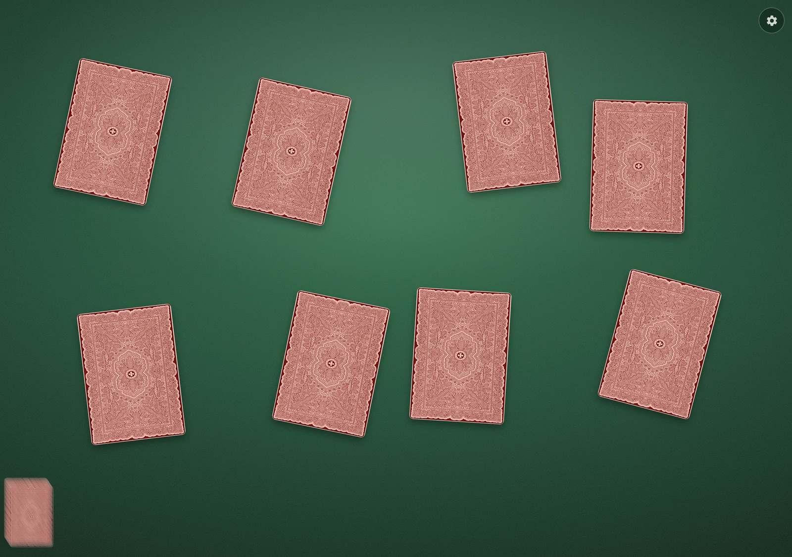
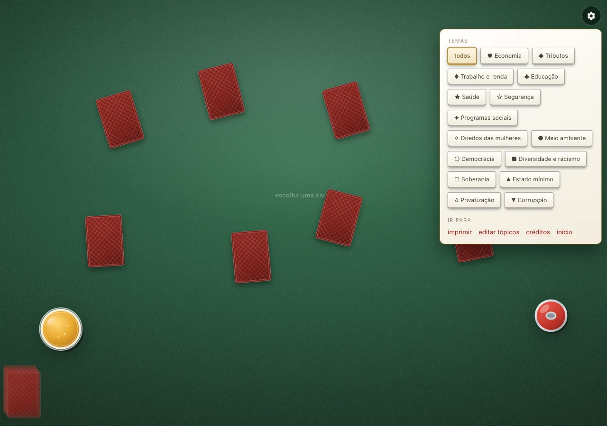
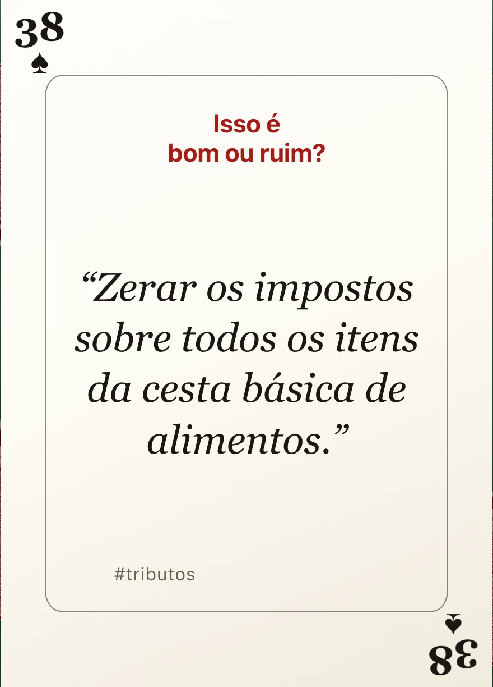
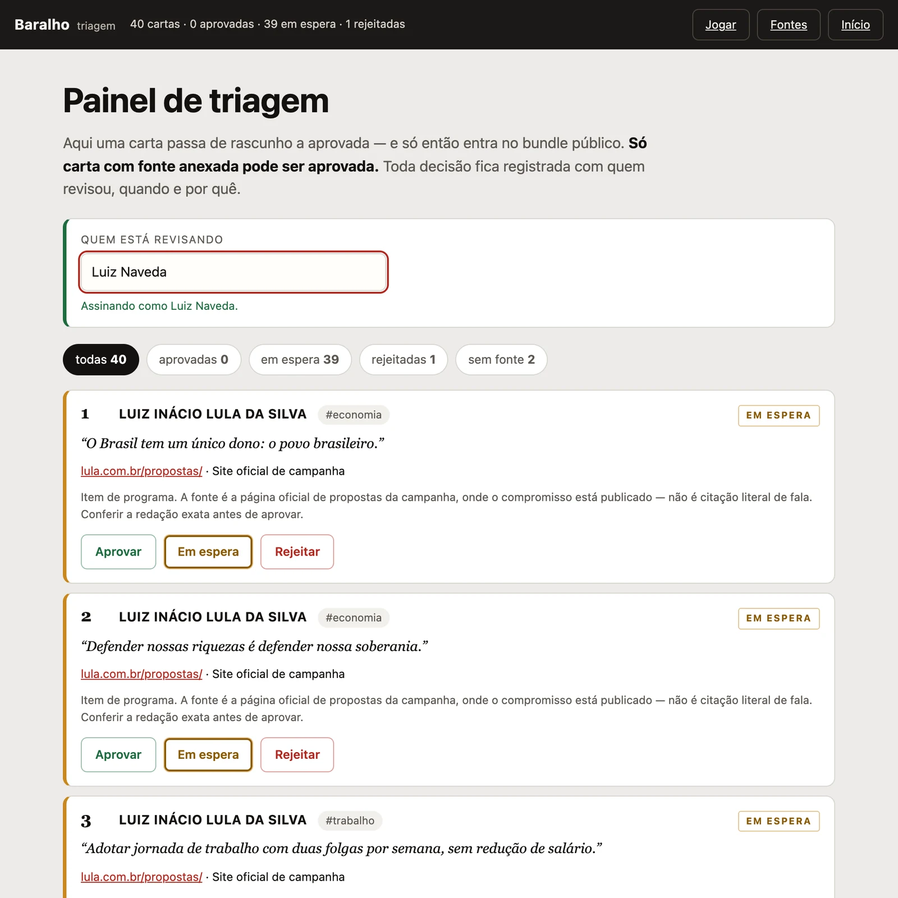
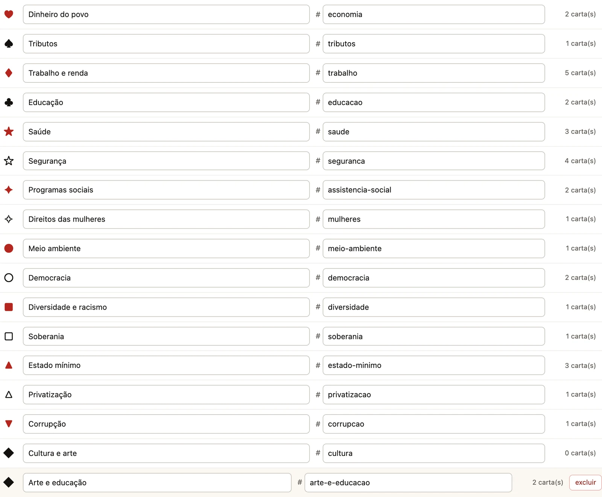
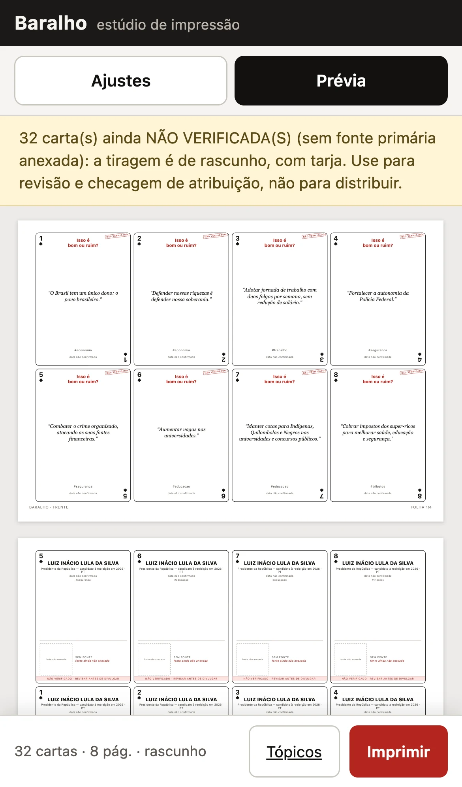

# baralho-app — cartas de citações políticas com a fonte no verso

App web para imprimir e jogar um baralho de citações: a **frente** mostra só a
frase ("Isso é bom ou ruim?"), o **verso** revela quem disse, com data, link e
**QR code** que abre a fonte oficial.

**Estado:** **jogo**, **estúdio de impressão**, **editor de tópicos** e **página
de créditos** prontos e verificados, com a interface adaptada para celular (e
instalável como app). O painel de triagem de fontes ainda não foi construído — o
plano está em [`docs/PLANO.md`](docs/PLANO.md).

---

## Rodar

```bash
node baralho-app/web/server.mjs          # http://127.0.0.1:4178
```

- `/` — página inicial (com a seção de créditos)
- `/jogo.html` — **o jogo**: uma carta por vez, julgar antes de saber quem disse
- `/print.html` — **estúdio de impressão**
- `/print.html?teste=1` — folhas de teste de alinhamento frente/verso
- `/topicos.html` — **meus tópicos**: renomear temas, criar tópicos próprios e atribuir cartas
- `/creditos.html` — **créditos**: autoria, baralho de referência, fontes, terceiros e aviso
- `/manifest.webmanifest` — manifesto do app (instalável no celular)
- `/api/cards` — cartas (**só `approved`**); `?draft=1` inclui as em rascunho
- `/api/topics` — taxonomia de temas
- `/api/creditos` — conteúdo da página de créditos
- `/api/health` — estado do conjunto de dados

Sem dependências: só Node ≥ 18. Nada sai da máquina.

Variáveis: `BARALHO_PORT` (4178), `BARALHO_HOST` (127.0.0.1),
`BARALHO_DATA` (nome de um arquivo em `data/`; usado para fixtures e testes).

---

## O jogo — a mesa



**As cartas caem espalhadas sobre o feltro e você escolhe uma.** A posição e o
giro de cada carta são sorteados (grade frouxa + jitter), então a mesa fica como
mesa de boteco de verdade — não uma fila arrumada. A citação é o elemento
dominante da face, e as cartas são grandes: **~240 px de altura no computador e
~145 px no celular**.

**O espalhamento é feito em duas fases.** Sem carta escolhida, as cartas ocupam a
mesa toda. Ao escolher, a grade passa a **desviar do retângulo onde a carta grande
vai ficar**, e as outras se reposicionam com transição — as cartas "abrem espaço".

A regra que isso garante: **o centro de cada carta espalhada nunca cai dentro da
carta escolhida**. Sem ela, uma carta podia ficar inteiramente atrás da grande e
virar impossível de clicar — foi um teste que pegou isso. O jitter de cada carta é
validado contra esse retângulo, senão ele devolvia a carta para dentro da área
reservada.

No celular a geometria é outra: a carta escolhida vai para o alto e as espalhadas
ficam numa faixa embaixo, com 3 cartas por mesa — menos cartas, cartas maiores.

**Uma engrenagem no canto guarda tudo o que não é baralho**: os temas e a
navegação (imprimir, tópicos, créditos, início). Fora dela, a tela é só a mesa.
Fecha com `Esc` ou clicando fora.



| gesto | o que faz |
|---|---|
| clicar numa **carta da mesa** | ela vem para o centro e mostra a citação |
| clicar na **carta do centro** | vira: autor, data e **fonte** |
| clicar no **QR ou em "ver a fonte"** | abre a fonte em outra aba |
| clicar no **feltro** | devolve a carta à mesa (mesma coisa com `Esc`) |
| clicar no **monte** | distribui novas cartas |
| `←` `→` | anda pelas cartas da mesa |
| `S` | embaralha e redistribui |

**Design no espírito do Copag 139**, sem usar a marca — seguindo as referências
que o usuário mandou:

- **Frente**: o índice (número sobre o naipe) fica no **branco da margem**, fora
  de um **retângulo de contorno fino** que enquadra a citação, com o índice
  espelhado no canto oposto. É assim que o Copag monta a face, e é diferente do
  fio duplo que havia antes.
- **Verso**: **o padrão exato do baralho de referência**, recortado da imagem que
  o usuário enviou (`web/public/padrao-dorso.webp`) — a renda simétrica com a
  borda ondulada e o medalhão central. A foto de origem é clara e dessaturada, e
  a resolução não sustenta o traço fino da gravura, então o recorte passa por um
  **mapeamento duotone** (vermelho escuro → vermelho claro) que devolve a cor do
  Copag sem inventar detalhe que a fonte não tem.

O cartucho oval branco com nome, data e fonte fica por cima do medalhão.

O copo é o **Copo Americano** da Nadir Figueiredo (1947, 190 ml) — conhecido em
Belo Horizonte como "copo lagoinha", por causa do bairro boêmio; é peça do acervo
de design do MoMA.




**O QR é desenhado como carta** — módulos arredondados, localizadores em anel,
moldura dourada, naipes nos cantos e o naipe do tema no centro
([exemplo](docs/exemplo-qr-carta.webp)). Parece ornamento e continua legível: a
verificação renderiza o SVG no Chrome e decodifica com leitor independente.

**O clique pertence à carta, não ao container dela.** O `.mao` é um retângulo que
cobre quase toda a mesa; tratar "clique dentro do `.mao`" como clique em carta
engolia o clique no feltro — devolver a carta só funcionava na estreita margem de
fora. A regra olha para os elementos `.carta-mesa`, não para o container.

**O que o código garante:** o nome do autor **não existe no DOM** antes de virar
a carta — nem o da carta anterior, nem depois de devolvê-la à mesa. O verso é
montado na revelação e esvaziado na escolha seguinte ou ao recolher. Isso inclui
o `aria-label` da carta: ele também guardava o nome, e o teste pegou. Sem fonte anexada, não inventa QR: mostra "fonte não anexada" e
carimba a carta como NÃO VERIFICADA.

**O QR e o endereço são um alvo de clique único** (`a.carta__fonte-link`), com o
`stopPropagation` necessário para que abrir a fonte não desvire a carta. O
verificador abre o link de verdade e confere a URL.

---

## A planilha é a fonte das cartas

As cartas vivem num **CSV**, uma linha por carta — é onde a pesquisa é editada,
no Excel, no Numbers ou no Google Sheets:

```
data/cards.csv        ← a fonte (editável em planilha)
data/cards.meta.json  ← o que não é carta: versão, aviso, campos obrigatórios
data/cards.seed.json  ← GERADO do CSV; é o que o app lê
```

```bash
node tools/cards-csv.mjs exportar   # JSON → CSV
node tools/cards-csv.mjs importar   # CSV → JSON
node tools/cards-csv.mjs conferir   # falha se os dois saírem de sincronia
```

O JSON é commitado para o app rodar sem passo de build — mas **ele é artefato,
não fonte**. O `conferir` (e o `smoke.mjs`) garantem que os dois não divirjam:
se alguém editar o JSON à mão, o teste pega.

O CSV é lido e escrito por um parser RFC 4180 próprio (`lib/csv.mjs`), porque as
citações e as observações têm vírgula, aspas e quebra de linha. Nada de
dependência: o projeto continua zero-dep.

**O que o importador valida** — o que quebraria o app em silêncio:

| regra | por quê |
|---|---|
| `id`, `quote`, `topic`, `status`, `contributor` obrigatórios | sem eles a carta não existe |
| `status` só `approved`, `wait` ou `reject` | vocabulário fechado |
| `numeroNaCarta` inteiro e único | é o número impresso na carta |
| `id` único | é a chave |
| aprovada exige fonte | a regra dura, agora também na planilha |
| rejeitada exige motivo | a decisão precisa ser auditável |
| coluna desconhecida é erro | coluna nova sem tratamento é dado perdido |

---

## Painel de triagem — `/triagem.html`



É aqui que uma carta deixa de ser rascunho. Sem esta tela a regra dura do app
ficava só na leitura: dava para filtrar `approved`, mas não havia como aprovar
nada — o baralho nunca chegaria ao público.

**A revisão vive em arquivo separado** (`data/curadoria.json`), então o arquivo
de pesquisa (`cards.seed.json`) nunca é reescrito. Cada decisão guarda **quem
revisou, quando e por quê**:

```json
"C33": { "status": "approved", "revisor": "…", "em": "2026-10-12T20:51:59.587Z", "motivo": null }
```

As regras valem nas **duas pontas** — na tela e no servidor, porque uma não pode
confiar na outra:

| regra | por quê |
|---|---|
| aprovar exige fonte anexada | é a regra dura: acusação sem fonte não circula |
| rejeitar exige motivo | a decisão precisa ser auditável |
| toda decisão exige revisor identificado | sem autoria, não é revisão |
| só carta existente pode ser revisada | id inventado não entra no arquivo |

Aprovar uma carta a faz **sair no bundle público** (`/api/cards`, sem `draft=1`)
na mesma hora. É o caminho completo: pesquisa → revisão → público.

### A API

```
GET  /api/curadoria   → revisão registrada de cada carta
POST /api/curadoria   → { id, status, revisor, motivo }
```

`POST` é a única escrita do servidor; todo o resto continua somente leitura. A
gravação é atômica (arquivo temporário + `rename`).

---

## Estúdio de impressão

Medidas em **milímetros** do começo ao fim: a pré-visualização é o que sai no papel.

**Folha e corte**
- Papel: A4 paisagem/retrato, Letter paisagem/retrato.
- 4, 6, 8 ou 9 cartas por folha (a grade se adapta à orientação).
- Tamanho: automático (preenche a folha mantendo a proporção de carta de pôquer)
  ou pôquer 63×88, bridge 57×89, mini 44×67 mm — com redução proporcional
  automática (e aviso) se não couber.
- Margem, espaçamento e linha de corte (borda contínua, tracejada ou nenhuma).

**Frente e verso**
- `duplex` — frente e verso alternados na mesma tiragem, **verso espelhado**
  para cair atrás da frente.
- `frente` / `verso` — para impressão manual em duas passagens (o verso sai
  espelhado do mesmo jeito, para casar com as frentes já impressas).
- `recortar-colar` — frente e verso lado a lado na mesma face, para quem não tem
  duplex: recorta, dobra e cola.
- QR code e/ou endereço da fonte por extenso no verso.

### Como o alinhamento duplex é calculado

Numa folha A4 paisagem a borda longa é a horizontal, então "virar na borda longa"
é um giro de cima para baixo. Depois desse giro, a linha de cima da frente cai na
linha de baixo — logo o verso precisa ser impresso com as **linhas invertidas**:

```
frente  (grade 4×2)          verso impresso        depois de virar a folha
1  2  3  4                   5  6  7  8            1  2  3  4
5  6  7  8                   1  2  3  4            5  6  7  8
```

Na borda curta o espelhamento é por **colunas**. Slots vazios da última folha são
preservados na mesma posição física, para uma tiragem incompleta não desalinhar.

Como cada impressora interpreta "borda longa" à sua maneira, imprima primeiro
`/print.html?teste=1` (ou o botão **Teste de alinhamento**): são duas folhas com
as posições numeradas e espelhadas como na impressão real. Segure contra a luz —
se `VERSO 3` cair atrás de `FRENTE 3`, está alinhado.

### Salvar em PDF

Na caixa de impressão do navegador escolha **Salvar como PDF**. Margens:
**nenhuma**. Desmarque **cabeçalhos e rodapés** (o rodapé do baralho já é
impresso na folha, com "frente/verso · folha n/total").

Também dá para mandar a configuração por link: **Copiar link destas opções**, ou
montar à mão com `?modo=duplex&porFolha=8&temas=economia,saude`.

---

## Meus tópicos — renomear e criar

Em `/topicos.html` o usuário organiza o baralho do jeito dele, sem editar arquivo:



- **Renomear** qualquer tema da taxonomia: o nome exibido (chips, filtros, listas)
  e a **etiqueta `#` que sai impressa na carta** são dois campos independentes,
  na mesma linha.
- **Criar tópico próprio**, com nome, símbolo e cor (♥ ♦ ♠ ♣ ★ ● ■ ▲ ◆…). A etiqueta
  `#` é derivada do nome e pode ser ajustada; nomes repetidos ganham sufixo
  (`arte`, `arte-2`).
- **Selecionar cartas** por busca, status e tópico atual, marcar em massa e
  **atribuir** ao tópico escolhido — ou **voltar ao tópico original**.
- **Exportar/importar `.json`** para guardar ou levar para outro aparelho.

### O modelo em uma frase

Uma carta aponta para uma **chave** de tópico: o slug da base (`economia`) ou o id
de um tópico próprio (`t1`). O id é estável — renomear um tópico próprio não
quebra as atribuições já feitas. A resolução é:

```
atribuição explícita  >  tema da base (com renomeação)
```

O que aparece onde:

| Onde | O que mostra |
|---|---|
| Chips, filtros, listas | o **nome** (renomeado ou próprio) |
| Etiqueta `#` na frente da carta | o **slug efetivo** — mude o campo `#` para mudar o que sai impresso |
| Verso da carta | `#slug · Nome` quando o nome difere do slug |

Nada sai do navegador: o overlay fica em `localStorage` (`baralho.topicos.v1`) e
o servidor nem sabe que ele existe. Opinião política é dado sensível (LGPD
art. 5º, II) — não há motivo para trafegar.

---

## Celular

Adaptado de verdade para o celular — não é só o layout encolhendo.



- **Abas Ajustes / Prévia** no estúdio de impressão: uma coisa de cada vez, sem
  rolar um painel longo para chegar na prévia.
- **Barra fixa ao pé da tela** com a ação principal e o resumo da tiragem
  ("32 cartas · 8 pág. · rascunho"), ao alcance do polegar.
- **Ajuste automático de escala**: a folha é reduzida para caber na largura da
  tela (arredondando para baixo, para nunca estourar), com o botão
  *Ajustar à largura da tela* para refazer.
- **Alvos de toque de ~44 px**, campos com 16 px de fonte (evita o zoom
  automático do iOS) e espaçamento seguro para o *notch*
  (`env(safe-area-inset-bottom)`).
- **Meus tópicos**: cada tema vira um cartão empilhado; ao marcar cartas, o grupo
  de atribuição vira uma **barra fixa no rodapé**.
- **Instalável**: `manifest.webmanifest` com ícones (192, 512 e maskable),
  `theme-color` e `apple-touch-icon` — dá para adicionar à tela inicial. Os
  ícones são gerados por `tools/gerar-icones.py` (Pillow), sem arte externa.

Cuidado que já custou caro: as abas escondem a prévia quando "Ajustes" está
ativa. Imprimir dali saía **em branco**. O `@media print` agora força a prévia a
aparecer seja qual for a aba, e há teste de regressão para isso.

---

## Créditos

Em `/creditos.html`, com uma versão curta na página inicial. O conteúdo é
**dado**, não código: fica em [`data/creditos.json`](data/creditos.json) e é
servido por `/api/creditos`.

São **três blocos, de propósito**: autoria, baralho de referência e aviso. A
referência ao original é o que não pode faltar — nome do baralho, autoria
indicada nos metadados, link da pasta de origem e a ressalva de que o original
não traz fonte e a licença de reuso não foi confirmada.

---

## Dados

Fonte de verdade: `data/cards.json` (curado) → cai para `data/cards.seed.json`
(pesquisa) quando não existe. `data/cards.demo.json` é um **fixture de teste**
com links, carregado só com `BARALHO_DATA=cards.demo.json`.

Campos por carta (os seis pedidos + o que a operação exige):

| Campo | Regra |
|---|---|
| `quote` | texto **literal**, 10–600 caracteres |
| `link` | fonte primária/oficial; **obrigatório se `approved`** |
| `topic` | slug da taxonomia em `data/topics.json` |
| `status` | `approved` · `wait` · `reject` |
| `contributor` | quem cadastrou |
| `relevance` | 1–5 |
| `autor`, `cargo`, `partido` | quem disse |
| `data`, `dataPrecisao` | ISO + `exata`/`dia`/`mes`/`ano`/`desconhecida` |
| `veiculo`, `arquivo`, `tagsOriginais`, `numeroNaCarta`, `observacao` | contexto e rastreabilidade |

**Regras duras, no código:**

1. `GET /api/cards` sem `draft=1` devolve **apenas `approved`** — carta não
   verificada não sai do servidor.
2. Sem `link` não existe QR: o verso mostra "fonte ainda não anexada" e o selo
   vermelho "não verificado · revisar antes de divulgar".
3. Cartas em rascunho saem com o selo "não verificado" no canto da frente.
   Desligar esse selo dispara um aviso em vermelho no topo.
4. A frente nunca contém o nome do autor — nem no HTML. Os símbolos são
   **uniformes** por padrão justamente para não dar pista: quando escolhidos por
   tema, um tema com cartas de um só autor entregaria a resposta.
5. `reject` fica fora da impressão em qualquer modo.

O seed tem **50 cartas**: **47 com fonte anexada**, **2 ainda sem**, e **1
rejeitada**.

- As **16 cartas de programa do campo Lula** apontam para a página oficial de
  propostas — não é citação de fala, e a observação diz isso.
- **10 cartas do eixo cultura, costumes e dança** (41–50), pesquisadas depois: 5
  do campo Bolsonaro e 5 do campo Lula, cada uma com o contraponto escrito na
  observação.
- As **6 cartas do campo Flávio** com fonte vêm de reportagem ou documento
  (anistia, agenda armamentista, "tesouraço", riscos ao SUS/Bolsa Família no plano
  fiscal, cobrança a Vorcaro), mais as **4 do livro "Flávio" (2017)**.
- As **2 sem fonte** (C25, Lei do Racismo; C27, contratar mulheres) não têm
  declaração localizada em lugar nenhum. Como o baralho já errou uma atribuição
  (a C26 é de Paulo Figueiredo), as duas ficam marcadas como **suspeitas de erro
  de atribuição**, e não como simples pendência de pesquisa.

**A carta C26 ("mulheres solteiras votam mal") foi rejeitada**: a frase é de Paulo
Figueiredo, e Flávio Bolsonaro repudiou publicamente. A atribuição do baralho
estava errada — o motivo está gravado em `motivoRejeicao`.

Duas cartas trazem observação de **contradição**: a C20 (antivacina) — o
candidato afirma ter se vacinado — e a C29 (aposentadoria), que a campanha nega.
Em ambas o texto do baralho é interpretação, não fala literal.

Todos os **15 links distintos** foram testados: respondem 200.

Como nada foi aprovado ainda, a impressão e o jogo saem em modo rascunho, com o
carimbo NÃO VERIFICADO.

---

## QR code

O QR é gerado **localmente** (`lib/qr.mjs`, modo byte, versões 1–40, níveis
L/M/Q/H) e aponta para o mesmo link escrito no verso — nunca para um encurtador.

As tabelas da norma vêm de um gerador, não de digitação:
`tools/gen-qr-tables.mjs` deriva `lib/qr-tables.mjs` de uma implementação de
referência e valida as invariantes da ISO/IEC 18004 (blocos ≤ 255 codewords,
ECC ≤ 30 por bloco, capacidade de dados).

O encoder foi verificado de forma independente:

```bash
mkdir -p /tmp/qrverify && cd /tmp/qrverify && npm i qrcode jsqr
node baralho-app/tools/verify-qr.mjs /tmp/qrverify
```

- **536** matrizes comparadas máscara a máscara com a biblioteca `qrcode`
  (versões 1–40 × 4 níveis): **0 divergências**;
- escolha automática de máscara idêntica à da referência em **67/67** casos;
- **67/67** decodificações corretas pelo leitor independente `jsqr`.

E o caminho completo foi testado no material impresso: o PDF gerado pelo Chrome
foi rasterizado a 300 dpi e o QR **impresso** foi lido por `jsqr`, devolvendo a
URL exata (inclusive a de snapshot, bem longa).

---

## Testes

```bash
node baralho-app/test/smoke.mjs                        # 966 verificações, zero dependências
node baralho-app/tools/verify-qr.mjs      /tmp/qrverify   # QR contra referência externa
node baralho-app/tools/verify-jogo.mjs    /tmp/qrverify   # a mesa num navegador
node baralho-app/tools/verify-topicos.mjs /tmp/qrverify   # editor de tópicos
node baralho-app/tools/verify-mobile.mjs  /tmp/qrverify   # todas as páginas em celular
node baralho-app/tools/verify-triagem.mjs /tmp/qrverify   # painel de triagem, ponta a ponta
```

O `verify-mobile` e o `verify-topicos` rodam contra o servidor que já estiver no
ar. Os outros sobem o próprio servidor.

O **`smoke.mjs`** cobre: integridade dos dados (50 cartas, campos, status, temas),
o **CSV** (ida e volta, aspas, vírgulas, quebras de linha, BOM, e a garantia de que
a planilha e o JSON não divergem),
operações de baralho (shuffle determinístico, filtros, espelhamento duplex),
a **camada de tópicos** (renomear, criar, atribuir, sanitizar, exportar/importar),
os **créditos e o manifesto**, a estrutura do QR e as rotas do servidor —
incluindo a tentativa de travessia de caminho. E, desde a triagem, as regras de
escrita: aprovar sem fonte, rejeitar sem motivo, revisar sem revisor, id
inexistente, e que **a curadoria não reescreve o arquivo de pesquisa**.

O **`verify-jogo.mjs`** sobe dois servidores sozinho — um com o fixture que tem
links e outro com um fixture sem fonte nenhuma — e percorre a mesa num Chrome de
verdade: escolhe carta, vira, confere QR e link, navega pelo teclado, embaralha,
abre a engrenagem, clica no feltro para devolver a carta, e confere que **nenhuma
carta fica atrás da escolhida e que todas são clicáveis**. Roda também em
viewport de celular. São **74 verificações**.

A checagem que dá sentido ao baralho: **nenhum nome de autor existe no DOM antes
de a carta ser virada** — nem o da carta anterior, nem depois de devolvê-la.

O **`verify-triagem.mjs`** sobe o próprio servidor com um arquivo de curadoria
**descartável** (o teste escreve, e não pode sujar a revisão de verdade) e prova o
caminho completo: sem revisor os botões não agem; só as cartas com fonte podem ser
aprovadas; aprovar faz a carta **sair no bundle público**; rejeitar exige motivo e
o motivo fica gravado; o arquivo de pesquisa continua intocado; e recarregar o
painel mantém a decisão. São **31 verificações**.

O **`verify-topicos.mjs`** percorre o fluxo real do editor: cria um tópico,
renomeia outro, atribui cartas em massa e confere que o estúdio de impressão passa
a filtrar e a imprimir com o tópico novo. São **20 verificações**.

O **`verify-mobile.mjs`** roda num iPhone 13 emulado e confere, nas páginas:
nenhuma rolagem lateral, alvos de toque, abas do estúdio, a folha cabendo inteira
na tela, a barra fixa de atribuição, os créditos, o índice de fontes, a mesa e a
regressão de impressão em branco. São **64 verificações**.

---

## Arquivos

```
baralho-app/
├── data/
│   ├── cards.csv          # AS CARTAS (fonte: edite aqui, em planilha)
│   ├── cards.meta.json    # metadados do conjunto (não são cartas)
│   ├── cards.seed.json    # gerado do CSV — é o que o app lê
│   ├── curadoria.json     # a revisão: status, revisor, data, motivo
│   ├── cards.demo.json    # fixture com links (só para teste)
│   ├── cards.semfonte.json# fixture sem fonte (só para teste)
│   ├── topics.json        # 16 temas: slug, label, símbolo, cor, sinônimos
│   └── creditos.json      # fonte única da página de créditos
├── lib/
│   ├── qr.mjs             # encoder + SVG (zero-dep, roda no Node e no navegador)
│   ├── qr-tables.mjs      # tabelas da norma (gerado)
│   ├── csv.mjs            # CSV RFC 4180: parser e escritor (zero-dep)
│   ├── deck.mjs           # filtro, shuffle com seed, espelhamento duplex, data
│   ├── jogo.mjs           # regras do jogo: rodada, sessão, resumo (puro)
│   ├── topics.mjs         # overlay de tópicos: renomear, criar, atribuir (puro)
│   └── store.mjs          # persistência local, exportar/importar, placar
├── tools/
│   ├── cards-csv.mjs      # exportar / importar / conferir a planilha de cartas
│   ├── gen-qr-tables.mjs  # regenera as tabelas a partir da referência
│   ├── gerar-icones.py    # ícones do app (192/512/maskable) com Pillow
│   ├── verify-qr.mjs      # verificação independente do encoder
│   ├── verify-jogo.mjs    # o jogo num navegador, com e sem fonte
│   ├── verify-topicos.mjs # fluxo de tópicos num navegador de verdade
│   ├── verify-triagem.mjs # painel de triagem, ponta a ponta
│   └── verify-mobile.mjs  # todas as páginas em viewport de celular
├── web/
│   ├── server.mjs         # node:http, estático + API
│   └── public/
│       ├── index.html     # início + créditos resumidos
│       ├── jogo.html      # o jogo
│       ├── jogo.css
│       ├── jogo.js
│       ├── padrao-dorso.webp # textura do verso (o padrão do baralho de referência)
│       ├── fontes.html    # índice de fontes (o que cada carta cita)
│       ├── triagem.html   # painel de triagem (é aqui que a carta é aprovada)
│       ├── print.html     # estúdio de impressão
│       ├── print.css      # mm de ponta a ponta + @media print + celular
│       ├── print.js       # composição das folhas, QR, abas, escala
│       ├── topicos.html   # editor de tópicos
│       ├── topicos.css
│       ├── topicos.js
│       ├── creditos.html  # créditos completos
│       ├── creditos.css
│       ├── creditos.js
│       ├── manifest.webmanifest
│       ├── favicon.svg
│       └── icone-192.png · icone-512.png · icone-maskable.png
├── test/smoke.mjs
├── docs/PLANO.md
├── docs/exemplo-impressao.pdf
├── docs/exemplo-topicos.webp
├── docs/exemplo-celular.webp
├── docs/exemplo-creditos.webp
└── README.md
```

---

## Antes de distribuir

- Nenhuma carta entra em circulação sem **fonte primária + snapshot + revisor**.
  Atribuir a alguém real algo que não disse é difamação.
- **Confirme a autoria e a licença do baralho de origem.** Os metadados do PDF
  trazem apenas "Regiane"; o crédito só é honesto depois de confirmado com quem
  produziu — e o conteúdo das 32 cartas é de outra pessoa.
- Opinião política é dado sensível (LGPD art. 5º, II): aqui tudo fica em
  `localStorage`, sem analytics e sem servidor — mantenha assim.
- Material de campanha na internet tem regras eleitorais próprias (inclusive
  impulsionamento pago): revise com apoio jurídico antes de divulgar.

## Próximos passos

1. **Painel de triagem** — cadastrar citação, colar link, aprovar/aguardar/rejeitar
   com trilha de auditoria, e gerar `data/cards.json` só com aprovadas. É o que
   falta para o jogo sair do modo rascunho.
2. **Curadoria** — 15–25 cartas com fonte primária e snapshot.
3. **Compartilhar** — imagem da carta sempre com autor e fonte, e Open Graph por carta.
4. **Modo turma** — várias pessoas na mesma rodada, com placar agregado (hoje o
   placar é de um aparelho só).

### Ideias para a camada de tópicos

- **Arrastar e soltar** cartas entre tópicos, no lugar do select + atribuir.
- **Salvar conjuntos** ("meu baralho de campanha") com nome, tópicos e ordem, e
  um link que reabre a impressão exatamente naquele recorte.
- **Tópicos por público** em vez de por assunto (juventude, trabalhadores,
  evangélicos), que costuma ser o recorte que muda voto.
- **Levar o overlay para o `data/cards.json`** quando a curadoria existir, para
  o tópico renomeado valer também no modo de jogo e no compartilhamento.
